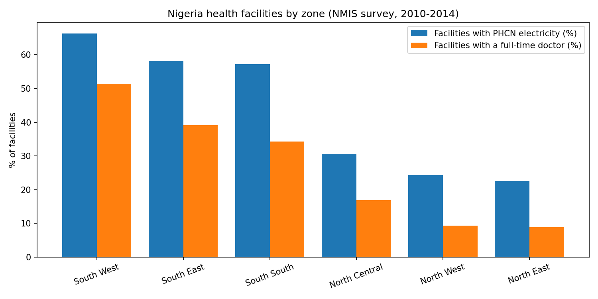

# Nigeria Health Facilities: A SQL Analysis

SQL analysis of 34,139 health facilities across Nigeria's 36 states and the FCT, using the NMIS baseline survey (2010-2014). Built with SQLite and Python (pandas, matplotlib) in Google Colab.

## Questions answered
1. How are facilities spread across states and facility types?
2. How much of the system is public versus private?
3. How many facilities have grid electricity or a full-time doctor?
4. How do the six geopolitical zones compare?

## Key findings
- **The north-south gap is large.** In the South West, 66.3% of facilities have PHCN (grid) electricity and 51.4% have a full-time doctor. In the North East, those figures are 22.6% and 8.9%.
- **Nationally, about 40% of facilities with a known answer have grid electricity.** The ten states with the lowest share are all in the north, led by Taraba (8.7%) and Zamfara (14.2%).
- **Public facilities dominate:** about 73% of all facilities are government-run. Lagos is the only state where private facilities are more than half (51.6%), followed by Ogun (46.9%).
- **Primary health centres are the backbone,** with 13,074 facilities after merging inconsistent labels.

## SQL techniques used
`SELECT`, `WHERE`, `GROUP BY`, `HAVING`, `CASE WHEN`, string functions (`substr`, `instr`), `CREATE TABLE AS`, `JOIN`, subqueries and the window function `RANK() OVER`.

## Data cleaning decisions
- **State names** were not a separate column, so I extracted them from the `unique_lga` field (for example `cross_river_obudu`) and fixed the multi-word states Akwa Ibom and Cross River.
- **Facility types** had inconsistent labels for the same thing (for example "Primary Health Center" and "Primary Health Centre (PHC)"), so I merged 8 labels into 3 and grouped 386 missing or unclear values as Unknown.
- **Missing values** were kept and excluded from percentages. About 14% of management values and about 13% of electricity values are missing.
- **Geopolitical zones** come from a small lookup table I created from the six standard zones, then joined to the facilities.

## Limitations
- The data is a **2010-2014 survey**, so it shows that period, not Nigeria today.
- The electricity column measures **PHCN grid power only**. A facility could still use a generator or solar power.
- State counts depend on how much of each state the survey covered, and the data has no population column, so I compare shares of facilities, not facilities per person.
- The findings show gaps, not causes.

## Data source
Nigeria NMIS health facility data (baseline survey, 2010-2014), published by the Nigeria MDGs Information System (http://nmis.mdgs.gov.ng/) and distributed through openAFRICA / Code for Africa: https://open.africa/dataset/health-facilities-in-nigeria

Licensed under Creative Commons Attribution (CC BY). The data file is not included in this repository because of its size; download it from the link above.

## Notebook
See `nigeria_health_facilities_sql.ipynb`.
